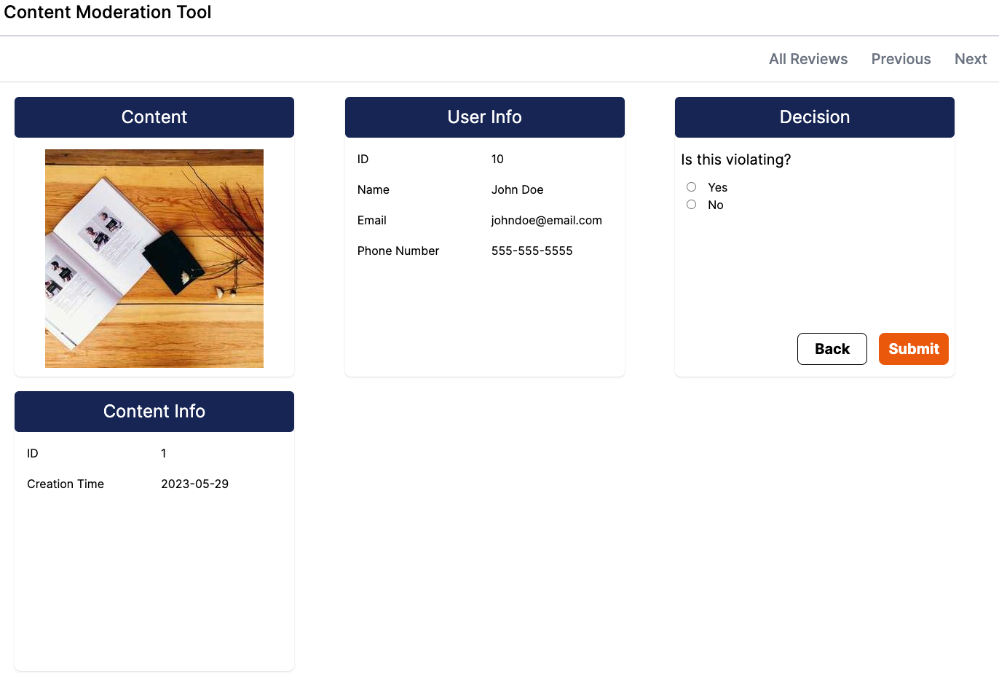

# Content Review Tool



An open-source content moderation and review platform that enables organizations to efficiently review and moderate content through customizable decision trees and queue-based workflows.

## ✨ Features

- **📋 Queue-based Content Management**: Organize content reviews into customizable queues
- **🌳 Custom Decision Trees**: Create flexible decision workflows with JSON-based configurations
- **👥 User Metadata Tracking**: Comprehensive user information and review history
- **🖼️ Multi-content Support**: Handle both text and image content types
- **⚡ Real-time Updates**: Live queue counts and review status updates
- **🧪 Comprehensive Testing**: Full test coverage for both frontend and backend

You can read the full product specification [here](https://docs.google.com/document/d/1GcjrolAkemedJYWHDe9G63NyJ0MOy9ej5mvuh7tyrww/edit).

## 🏗️ Architecture

### Frontend (`cr-frontend`)
- **Framework**: Next.js 13.4.4 with TypeScript
- **Styling**: Tailwind CSS
- **Testing**: Jest with React Testing Library
- **Port**: `localhost:3000`

### Backend (`cr-backend`)
- **Framework**: Django 4.2.3 with Python 3.10+
- **Database**: PostgreSQL
- **API**: RESTful endpoints
- **Testing**: pytest-django
- **Port**: `localhost:8000`

### Database Schema
- **DecisionTreeCR**: JSON-based decision workflows
- **QueueCR**: Review queues with optional decision trees
- **ReviewCR**: Content items with entity and user metadata

## 🚀 Quick Start

### Prerequisites
- PostgreSQL 12+
- Python 3.10+
- Node.js 16+

### Installation

1. **Clone the repository**
   ```bash
   git clone https://github.com/shug2k/content-review-tool.git
   cd content-review-tool
   ```

2. **Database Setup**
   ```bash
   # Ensure PostgreSQL is running
   sudo service postgresql start  # Linux
   brew services start postgresql  # macOS

   # Run database setup
   psql -U postgres -f cr-backend/setup.sql
   ```

3. **Backend Setup**
   ```bash
   cd cr-backend
   pip install -r requirements.txt
   python manage.py migrate
   python manage.py runserver
   ```

4. **Frontend Setup** (in a new terminal)
   ```bash
   cd cr-frontend
   npm install
   npm run dev
   ```

5. **Access the Application**
   - Frontend: http://localhost:3000
   - Backend API: http://localhost:8000

### Testing
```bash
# Backend tests
cd cr-backend && python -m pytest

# Frontend tests
cd cr-frontend && npm test
```

## 📖 API Usage

### Create a Queue
```bash
curl -X POST http://localhost:8000/create-queue \
  -H "Content-Type: application/json" \
  -d '{
    "name": "Content Moderation Queue",
    "decision_tree": {
      "start_question_tag": "is_violating",
      "questions": [
        {
          "tag": "is_violating",
          "text": "Is this content violating?",
          "answers": [
            {"tag": "yes", "text": "Yes", "decision": "remove"},
            {"tag": "no", "text": "No", "decision": "approve"}
          ]
        }
      ]
    }
  }'
```

### Create a Review Item
```bash
curl -X POST http://localhost:8000/create-review \
  -H "Content-Type: application/json" \
  -d '{
    "queue_id": 1,
    "entity_type": "text",
    "entity_content": "Sample content to review",
    "user_id": "user123",
    "user_name": "John Doe"
  }'
```

### Get All Queues
```bash
curl http://localhost:8000/queues
```

For more detailed API examples, check the [test files](cr-backend/tests/) in the backend directory.

## 🏛️ Project Structure

```
content-review-tool/
├── cr-frontend/           # Next.js frontend application
│   ├── app/              # Next.js 13 app directory
│   │   ├── page.tsx      # Queue listing page
│   │   ├── queue/        # Queue detail pages
│   │   └── review/       # Review interface
│   └── tests/            # Frontend test suite
├── cr-backend/           # Django backend API
│   ├── api/              # Main API application
│   │   ├── models.py     # Database models
│   │   ├── routes.py     # API endpoints
│   │   └── validators.py # Input validation
│   └── tests/            # Backend test suite
└── docs/                 # Documentation (coming soon)
```

## 🤝 Contributing

We welcome contributions! Please see our [Contributing Guide](CONTRIBUTING.md) for details.

### Development Workflow
1. Fork the repository
2. Create a feature branch: `git checkout -b feature/your-feature`
3. Make your changes and add tests
4. Run the test suite: `npm test` (frontend) and `pytest` (backend)
5. Commit your changes: `git commit -am 'Add new feature'`
6. Push to the branch: `git push origin feature/your-feature`
7. Submit a pull request

## 📋 Roadmap

- [ ] Docker containerization
- [ ] Authentication & authorization
- [ ] Real-time notifications
- [ ] Advanced analytics dashboard
- [ ] Bulk operations
- [ ] API rate limiting
- [ ] Export functionality

## 📄 License

This project is licensed under the Apache License 2.0 - see the [LICENSE](LICENSE) file for details.

## 📞 Support

- 📖 Documentation: [Product Specification](https://docs.google.com/document/d/1GcjrolAkemedJYWHDe9G63NyJ0MOy9ej5mvuh7tyrww/edit)
- 🐛 Issues: [GitHub Issues](https://github.com/shug2k/content-review-tool/issues)
- 💬 Discussions: [GitHub Discussions](https://github.com/shug2k/content-review-tool/discussions)
